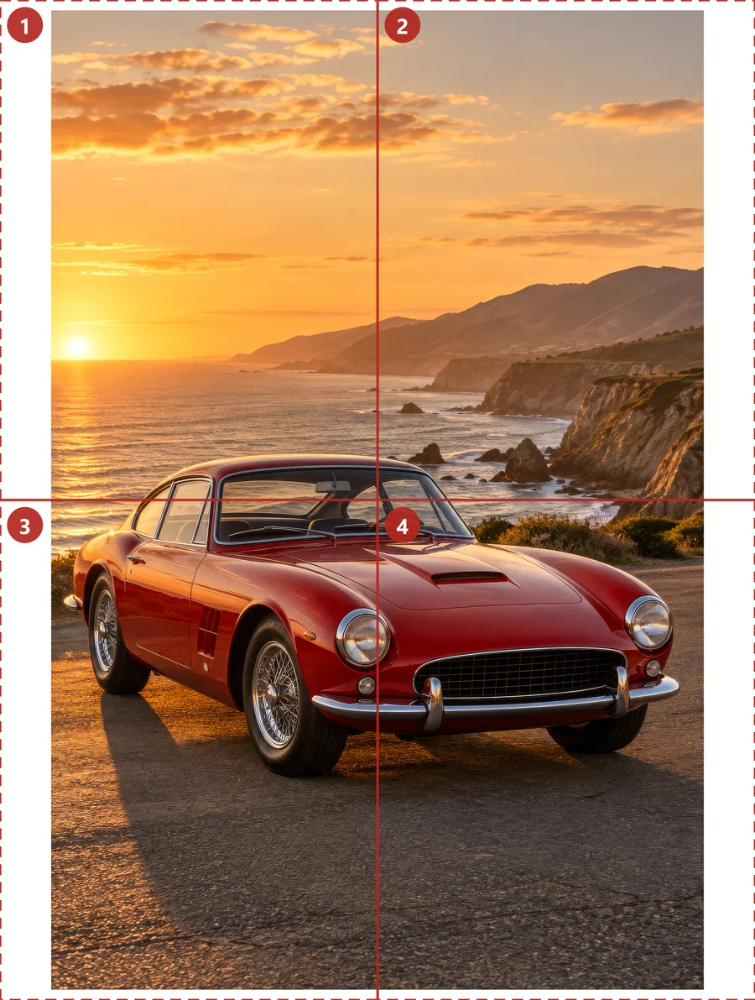

# Image Splitter

**Split any image into A4 or Letter pages and print it as a big poster, or cut it into equal pieces.** A free, open-source Rasterbator alternative with a halftone (dots) generator. It runs in the browser: no upload, no sign-up, no dependencies.

**Live demo:** https://maksis72.github.io/image-splitter/
**Full version** with standard poster sizes, a wall preview and color dots: [Image Splitter & Poster Printer on WooPoster](https://wooposter.com/image-splitter/)



## What it does

- **Poster printer:** splits a picture into A4 or US Letter pages (1 to 8 pages across, as many rows as it needs) and saves one PDF with cut marks and a page number on every page. Print at 100%, trim, tape: a big poster from a home printer.
- **Image splitter:** cuts the original picture into equal pieces (up to 20 x 20) at full resolution and saves them as JPG files in one ZIP, for an Instagram grid (3 x 3), a panorama carousel (3 x 1) or tile printing.
- **Halftone dots:** turns the picture into round black dots like the Rasterbator, so even a small photo looks sharp from a few steps away.
- **Print quality:** shows the DPI of the poster before you print.

The [full version](https://wooposter.com/image-splitter/) adds standard poster sizes (11 x 17 in to A0), A3, Legal and Tabloid paper, a preview of the poster on a wall next to a person, color dots from 0.5 mm, overlap for gluing and an assembly map page.

## How it works

| File | What it does |
|---|---|
| [`src/tiles.ts`](src/tiles.ts) | The grid: printable part of a page (paper minus a 10 mm margin), pages across and down, where the picture sits, DPI; equal pieces for the splitter |
| [`src/pdf.ts`](src/pdf.ts) | A tiny PDF writer: pages, JPEG images, lines and Helvetica text in WinAnsi encoding |
| [`src/zip.ts`](src/zip.ts) | A ZIP writer (stored files, CRC-32) |
| [`src/halftone.ts`](src/halftone.ts) | Halftone: dots on one grid over the whole poster, every other row shifted, size from brightness |
| [`src/app.ts`](src/app.ts) | The demo page |

Each page is drawn on a canvas at up to 200 DPI (dots up to 300 DPI) and stored as a JPEG in the PDF, so the poster comes out exactly the size you chose when you print at 100%.

## A Rasterbator and Block Posters alternative

Like the Rasterbator, it works in your browser and has a dots style. Unlike Block Posters, it never uploads your image. On top of that it cuts equal pieces as a ZIP, shows the print quality before you print, and the code is open source under the MIT license.

## Run it

Open `index.html` through any local web server (for example `python -m http.server`), or use the [live demo](https://maksis72.github.io/image-splitter/).

Build `app.js` from the TypeScript sources:

```sh
npm install
npm run build
```

## License

MIT, see [LICENSE](LICENSE). Made by [WooPoster](https://wooposter.com/), free online poster makers.
